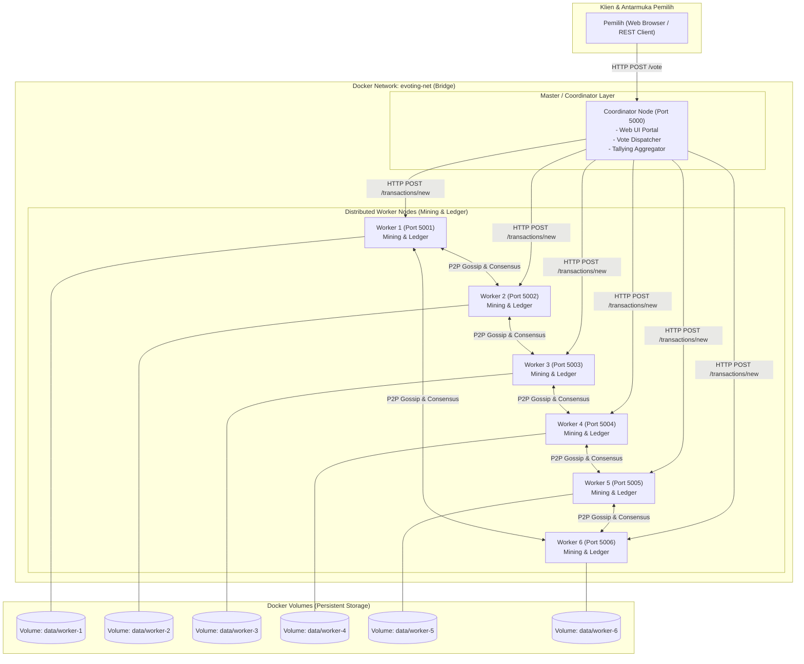
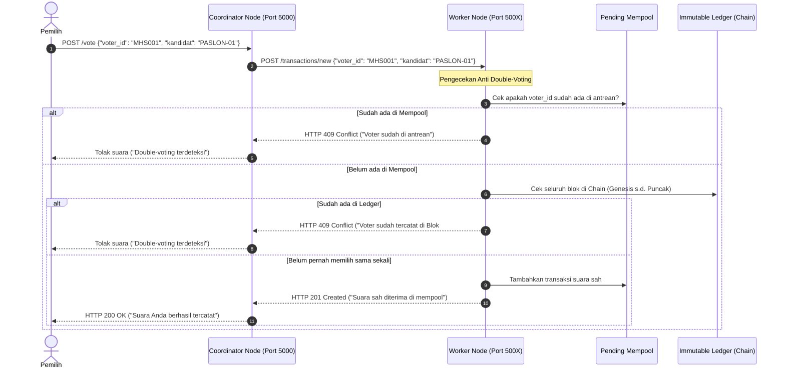
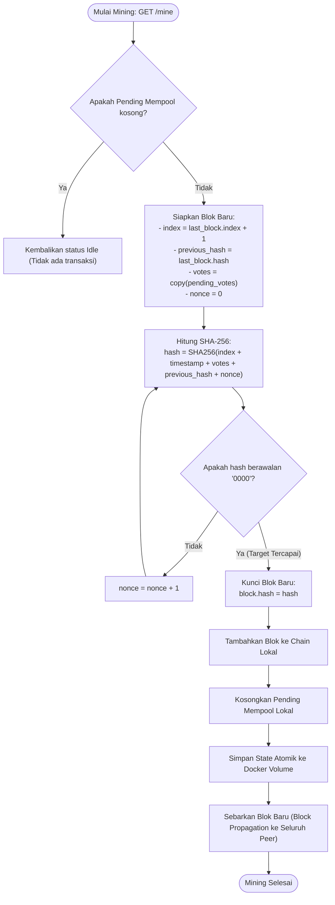
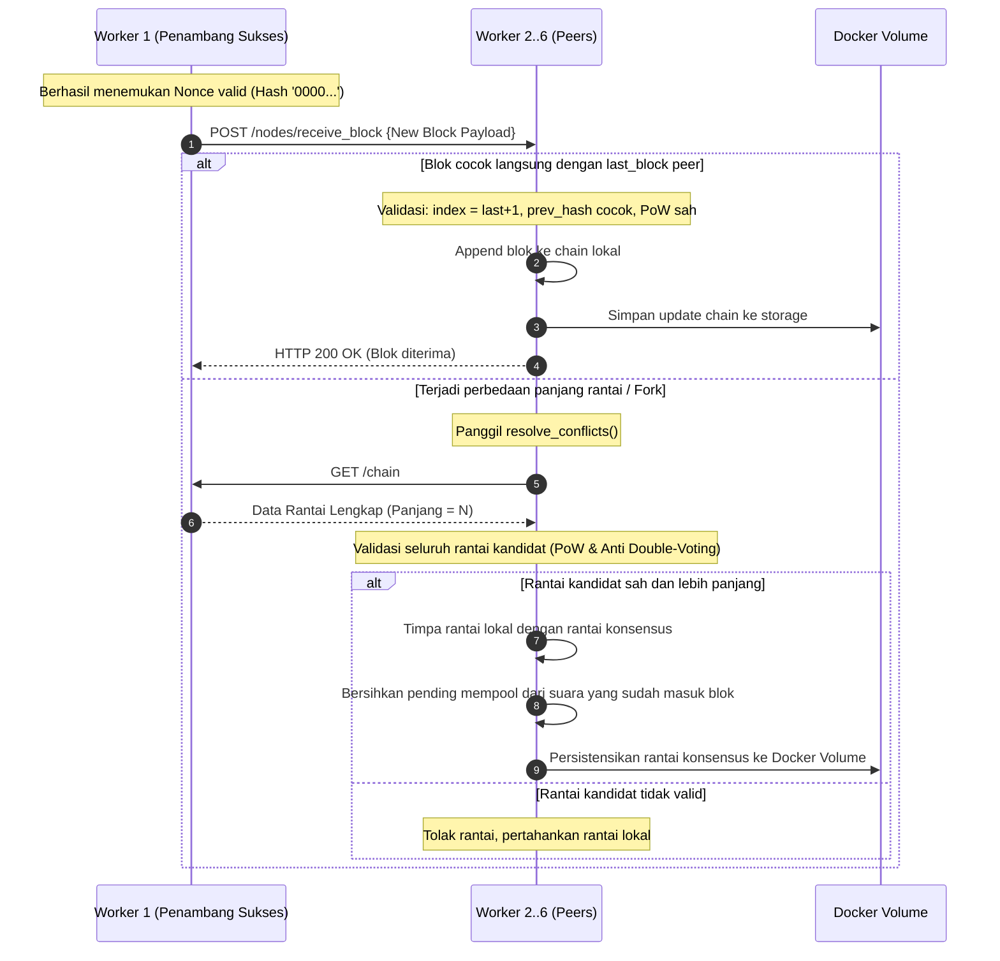

# Spesifikasi Arsitektur & Alur Sistem (EVB-02)
## Simulasi Sistem Voting Digital Terdistribusi Berbasis Proof-of-Work, Python Flask, dan Docker

**Penyusun:** Safid Nasih Ulwan (Senior Distributed Systems & Blockchain Engineer)  
**Mata Kuliah:** Komputasi Paralel dan Terdistribusi (KPT) - Semester 5  
**Proyek:** E-Voting Blockchain (EVB-02)

---

## 1. Ringkasan Eksekutif & Topologi Jaringan

Sistem *E-Voting Blockchain* ini dirancang dengan arsitektur **Master-Worker terdistribusi** yang berjalan di dalam jaringan virtual terisolasi (**Docker Bridge Network**) dengan persistensi data independen untuk setiap node (**Docker Named/Mounted Volumes**).

### Komponen Arsitektur:
1. **1 Master / Coordinator Node (Port 5000)**:
   - Gerbang utama pemilih (*Voting Web Portal*).
   - *Load Balancer* dan *Transaction Dispatcher* yang menyebarkan transaksi suara pemilih ke mempool worker.
   - Monitor kesehatan cluster worker dan agregator rekapitulasi hasil pemilu (*Tallying Engine*).
2. **6 Worker Blockchain Nodes (Port 5001 s.d. 5006)**:
   - Beroperasi sebagai *mining node* peer-to-peer (P2P).
   - Menjaga integritas *ledger* lokal secara independen.
   - Melakukan kompetisi Proof-of-Work (PoW) dengan kesulitan *4 leading zeros* (`"0000"`).
   - Menerapkan mekanisme konsensus *Longest Valid Chain* untuk rekonsiliasi percabangan rantai (*fork resolution*).
3. **Docker Storage Volumes (`/app/data`)**:
   - Volume terpisah untuk setiap container worker (`./data/worker-1` s.d. `./data/worker-6`) untuk menjamin sifat *Fault Tolerance* (node tetap mempertahankan ledger saat container restart/crash).

---

## 2. Diagram Topologi Jaringan Docker

Diagram berikut mengilustrasikan interkoneksi Master Node dan 6 Worker Nodes dalam lingkungan Docker:

---

## 3. Alur Transaksi Suara & Validasi Anti Double-Voting

Setiap suara yang dikirimkan pemilih melewati dua lapis validasi ketat sebelum dapat masuk ke dalam rantai blok:

---

## 4. Alur Algoritma Proof-of-Work (PoW) SHA-256

Worker menambang transaksi suara menggunakan algoritma hash SHA-256 dengan target tingkat kesulitan (*difficulty*) 4:

---

## 5. Alur Konsensus Terdistribusi (Longest Valid Chain Rule)

Ketika salah satu node menambang blok baru atau ketika terjadi percabangan (*fork*), konsensus dijalankan untuk merekonsiliasi seluruh node ke satu kebenaran tunggal (*single source of truth*):

---

## 6. Tabel Spesifikasi Endpoint REST API

| Modul | Endpoint | Method | Fungsi Utama | Status Response |
| :--- | :--- | :---: | :--- | :--- |
| **Coordinator** | `/` | `GET` | Antarmuka web voting dan status real-time cluster | `200 OK` (HTML) |
| **Coordinator** | `/vote` | `POST` | Menerima suara pemilih dan broadcast ke worker nodes | `200 OK` / `409 Conflict` |
| **Coordinator** | `/workers` | `GET` | Health check 6 worker container | `200 OK` (JSON) |
| **Coordinator** | `/trigger-mining` | `POST` | Menginstruksikan worker untuk menambang | `200 OK` (JSON) |
| **Coordinator** | `/tally` | `GET` | Rekapitulasi perolehan suara terverifikasi | `200 OK` (JSON) |
| **Coordinator** | `/chart` | `GET` | Gambar visualisasi grafik perolehan suara | `200 OK` (Image PNG) |
| **Worker** | `/status` | `GET` | Status node, panjang rantai, pending mempool, hash | `200 OK` (JSON) |
| **Worker** | `/chain` | `GET` | Salinan seluruh rantai blok lokal | `200 OK` (JSON) |
| **Worker** | `/transactions/new` | `POST` | Input transaksi suara baru + Anti Double-Voting | `201 Created` / `409 Conflict` |
| **Worker** | `/mine` | `GET` | Eksekusi Proof-of-Work SHA-256 | `200 OK` (JSON) |
| **Worker** | `/nodes/receive_block`| `POST` | Menerima blok baru hasil propagasi peer | `200 OK` / `202 Accepted` |
| **Worker** | `/nodes/resolve` | `GET` | Eksekusi konsensus Longest Valid Chain | `200 OK` (JSON) |
| **Worker** | `/nodes/register` | `POST` | Mendaftarkan alamat URL peer tetangga | `201 Created` (JSON) |
